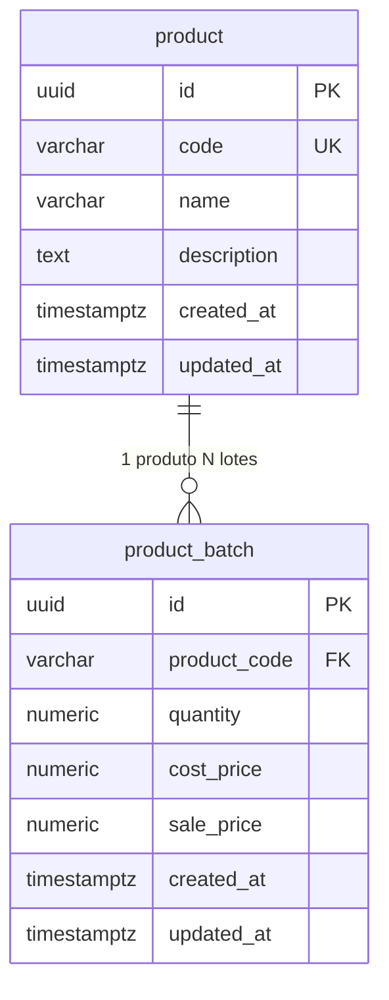

# stock-service

Microsserviço de estoque: produtos e lotes (PostgreSQL — database **`stock`**).



| Tabela | Papel | Relação |
|---|---|---|
| `product` | Catálogo de peças | 1 → N `product_batch` |
| `product_batch` | Lote com preço/qtd | `product_code → product.code` |

Auth: JWT emitido pelo **identity-service** (mesmo `JWT_SECRET`). Este MS só valida assinatura e papéis.

## Rodando local

```bash
docker network create oficina-net 2>/dev/null || true
cp .env.example .env
docker compose up -d          # stock :3002, postgres :5434, stock-localstack :4568
```

LocalStack **deste domínio** (`stock-localstack`, host **4568**): fila `stock-events`, policies + FilterPolicy. Fan-out SNS para order/billing/stock. Lab completo: [`../README.md`](../README.md).

## Saga (coreografia) e mensageria

Participa da **Saga coreografada** (SNS `oficina-domain-events` + SQS `stock-events`). `correlationId` = id da OS.

| Evento consumido | Ação |
|---|---|
| `billing.budget.generated` | Prepara reserva PENDING com peças do orçamento |
| `order.budget.approved` | Reserva FIFO → `stock.reserved` ou `stock.reservation.failed` |
| `billing.payment.confirmed` | Confirma reserva |
| `order.cancelled` / `order.budget.rejected` / `billing.payment.failed` | Libera estoque (`stock.released`) |

Tabela `stock_reservation` guarda itens e consumos para compensação.

Integração síncrona (billing): `POST /stock/quote`, `/stock/availability`, `/stock/decrease`.  
Lookup usado pelo order: `GET /stock/product/:code`.

Swagger: `/api`. Health: `/health/live`, `/health/ready`.

## CI/CD (AWS)

Deploy em **EKS** (sem Kind).

| Workflow | Quando | O que faz |
|---|---|---|
| `CI — stock-service` | push/PR | unit + integração + build |
| `Publish ECR — stock-service` | push `main` | push ECR + dispara deploy no `infra-kubernetes` |

Detalhes: [`infra/README.md`](infra/README.md).

## Observabilidade

Filtro: `service = 'stock-service'`.
