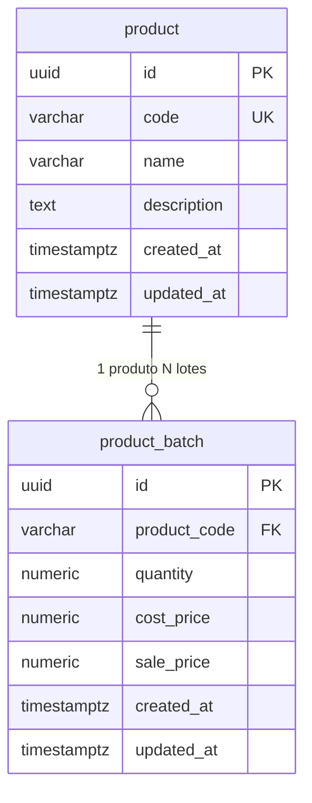

# stock-service

Microsserviço de estoque: produtos e lotes (PostgreSQL — database **`stock`**).

| Tabela | Papel | Relação |
|---|---|---|
| `product` | Catálogo de peças | 1 → N `product_batch` |
| `product_batch` | Lote com preço/qtd | `product_code → product.code` |

Auth: JWT emitido pelo **identity-service** (mesmo `JWT_SECRET`). Este MS só valida assinatura e papéis.

## Filas

Ainda **não**. HTTP. Na Saga (order ↔ stock), baixa de estoque tende a ir para fila — ainda não implementado.

## CI/CD

| Workflow | Quando | O que faz |
|---|---|---|
| `CI — stock-service` | push/PR | unit + integração (DB `stock`) + build |
| `CD — stock-service (Kind)` | manual | lab Kind com manifests `k8s/stock-*` |
| `Publish ECR — stock-service` | push `main` | push `stock-service` + `stock-service-migrations` |

## Observabilidade

Filtro: `service = 'stock-service'`.
